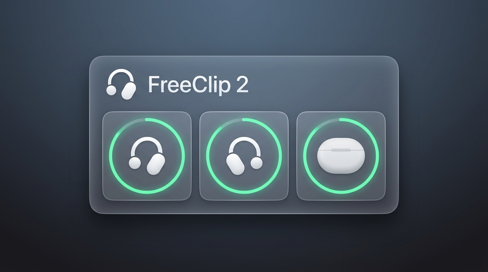
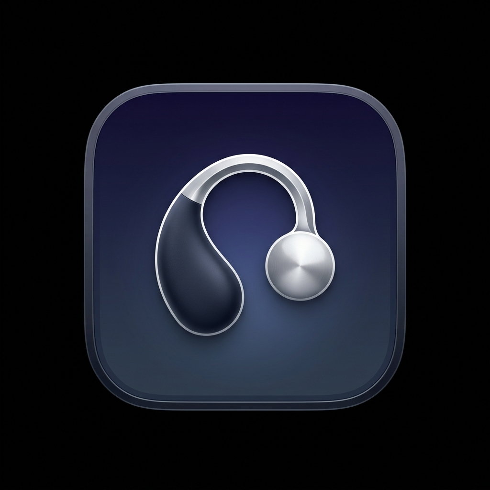

# FreeClip 2 for macOS

<p align="center">
  
</p>

<p align="center">
  
</p>

原生 macOS 菜单栏应用，基于 Swift 6、SwiftUI 与 `IOBluetooth`（Bluetooth Classic RFCOMM/SPP Channel 1）控制 **HUAWEI FreeClip 2 (BTFT0027)**。

## 主要功能

- **电量与位置识别**：永久绑定物理「耳机 1 / 耳机 2」与「充电盒」电量，并在右上角标注当前位置（`左耳` / `右耳` / `盒中`），支持左右耳自适应换戴同步与断线重连。
- **声音与手势控制**：支持 EQ 音效预设、低延迟模式，以及双击、三击、长按（左右耳独立）与滑动手势读写并经设备读回校验。
- **双设备管理**：查看已配对设备连接/播放状态，切换双设备开关、自动连接、首选设备与连接状态。
- **macOS 原生 Liquid Glass UI**：采用系统原生 `Glass.clear` 液态玻璃卡片与 `.ultraThinMaterial` 轻量磨砂背板，菜单栏显示自定义 FreeClip C 形桥矢量图标与较低耳电量。

## 构建与测试

```bash
# 构建 .app 包（arm64，ad-hoc 签名）
./build-app.sh

# 运行纯逻辑单元测试（Swift Testing）
./test-swift-testing.sh

# 运行协议与状态机烟测
./test-protocol.sh

# 运行真实硬件集成测试（需先在系统设置中配对 FreeClip 2）
FREECLIP_HARDWARE_TESTS=1 ./test-swift-testing.sh --filter readsBatteryAndPhysicalEarbudIdentityFromFreeClip2
```
